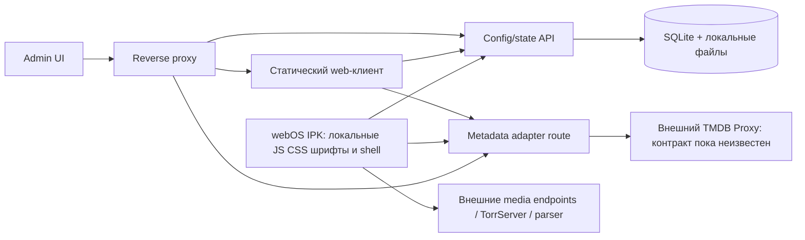

# Lampa Home: архитектура

Статус: предложение для согласования, только исследование. Проверено 2026-11-09. Код, сервер, образы и IPK не реализованы. Предлагаемые контракты не описывают существующий TMDB Proxy.

## Уточнение scope от 2026-11-10

Пользователь выбрал локальный домашний режим без авторизации на ближайших этапах. P06/P07 отложены; Config API и Admin UI не ждут login/pairing. Описанные далее device tokens, admin sessions и approval относятся к возможному будущему защищённому режиму. Для текущего режима LAN — выбранная граница эксплуатации, а не аутентификация; device/profile ID — логические ключи. [Roadmap](roadmap.md) отражает новый порядок. Это слияние разработки, не выпуск релиза.

## Основания и границы

Аудит привязан к `yumata/lampa-source@86c2b099b19f7058ea304dfa43a8b1e18a2e0492` (Manifest 3.4.6), `yumata/lampa@6fcdfab624f98ac0f7a91244e3d3b637f104a8c2`, `serezhia/lampa_selfhosted@16812a1392299c2016dfa9900581beabb947511f`. Это снимки веток на момент исследования, не обещание совместимости с будущими версиями. См. [аудит](upstream-audit.md), [CUB](cub-removal.md), [MetadataProvider](tmdb-provider-contract.md), [конфигурацию](config-system.md), [webOS](webos-packaging.md), [развёртывание](deployment.md), [план](roadmap.md).

Сохраняем Lampa, её UI, навигацию, локальный storage, плеер и поддерживаемые источники. Меняем границы интеграций: bootstrap/config, metadata transport, account/state, загрузка разрешённых плагинов. Не переносим коммерческие сервисы CUB или его приватные API. Функции, требующие серверных данных CUB (социальные рекомендации, комментарии и т.п.), скрываем или заменяем только при наличии независимого источника; локальные функции не должны теряться вместе с premium gating.

## Компоненты

На Pi работают два процесса приложения: reverse proxy и один Node.js backend. Admin UI и web-клиент — собранные статические файлы; SQLite — embedded БД, не отдельный контейнер. Metadata adapter является модулем backend, когда требуются секреты или преобразование неизвестного proxy API; клиентский фасад сохраняет Lampa-compatible вызовы. Baseline metadata идёт через домашний gateway/backend; прямой доступ к внешнему Proxy — отдельный режим только после аудита, без backend credentials на TV и после проверки CORS/TLS. Даже в таком режиме UI использует тот же фасад, а mapping остаётся внутри адаптера. Не создавать дополнительный metadata микросервис. Медиапоток идёт напрямую к источнику, без обязательного транскодирования на Pi.

### Границы доверия

TV получает только публичные effective settings и свой отзываемый device token. Админская сессия не доступна TV. Секреты TMDB Proxy/парсера остаются на backend; для секретных запросов используются узкие server routes, а не универсальный URL proxy. LAN не считается авторизованной зоной: pairing с подтверждением администратором, TLS где поддерживается TV, ограничения источников, CSRF для cookie-сессий, лимиты запросов. Плагин выполняется в привилегированном JS-контексте Lampa: allowlist без фиксации содержимого недостаточен. Поставляем проверенные локальные версии с digest; произвольная установка URL несовместима с гарантией отсутствия CUB.

## Порядок загрузки

1. Локальный IPK загружает shell и встроенные defaults; запуск не ждёт DNS, Pi, metadata или плагинов.
2. Загружается проверенный last-known-good config, затем локальные пользовательские предпочтения в разрешённых policy пределах. Данные состояния читаются отдельно.
3. UI становится интерактивным; config refresh и pairing выполняются асинхронно с ограниченным timeout.
4. Валидный совместимый config атомарно заменяет snapshot; URL/плагины переключаются между операциями, не посреди воспроизведения. Несовместимые или неверные ответы сохраняются только в диагностике, не активируются.
5. Состояние синхронизируется через outbox и серверный cursor; metadata грузится по требованию. При недоступности Pi работают настройки, локальное избранное/история и доступные локальные данные. Новые каталоги без сети не обещаются.

Единственная локально управляемая инфраструктурная настройка — адрес домашнего сервера и pairing/reset; её нельзя навсегда заблокировать недоступной серверной конфигурацией. Первый запуск без Pi открывает рабочий shell и экран подключения.

## Хранение и обновления

SQLite хранит immutable config revisions, devices, profiles, state events/materialized state, admin session metadata и audit events. Файлы содержат pinned plugins и ограниченный image cache. Сервер — источник административной policy; клиент — источник неподтверждённых локальных событий. Удаления представлены tombstones. Не смешивать JSON export настроек с полным backup БД и секретов.

IPK обновляется отдельно от серверной policy: сервер не заменяет JS оболочку при запуске. Клиент объявляет поддерживаемые версии config/provider/state API; backend сохраняет совместимость как минимум с предыдущим поддерживаемым IPK. Upstream обновляется отдельными небольшими изменениями на зафиксированный SHA с повторением regression matrix, без автоматической сборки latest на домашнем Pi.

## ADR — предложенные решения

| ID | Решение | Причина и последствие | Статус |
|---|---|---|---|
| ADR-001 | Малый maintained fork + изолированные адаптеры | Не переписывать UI; maintain patch ledger с upstream файлами и тестами | Предложено |
| ADR-002 | Локальный packaged webOS shell | Старт без Pi; обновление кода требует нового IPK | Предложено |
| ADR-003 | Один Node backend и SQLite WAL | Несколько домашних устройств не требуют Redis/PostgreSQL; один writer и backups | Предложено |
| ADR-004 | Config отдельно от пользовательского state | Разные lifecycle, разрешения и merge semantics | Предложено |
| ADR-005 | CUB удалять по исходящим путям, не только по UI | Скрытое меню не блокирует background requests | Предложено |
| ADR-006 | Metadata compatibility facade | Минимум изменений Lampa; конкретный proxy mapping после его аудита | Условно, API неизвестен |
| ADR-007 | Проверенные локальные plugins, digest pinning | Динамический код способен вернуть CUB; обновление требует review | Предложено |
| ADR-008 | Готовые ARM64 images и setup wizard | На Pi нет Node build/toolchain; простой повторяемый install | Предложено |
| ADR-009 | Polling с ETag вместо обязательного WebSocket | Меньше инфраструктуры; state sync на старте/foreground/событиях | Предложено |
| ADR-010 | Compatibility gate для каждого upstream bump | Сохранить 3.x Maker/Router contracts и старые TV engines | Предложено |
| ADR-011 | Не включать TorrServer/Jackett по умолчанию | Их lifecycle независим; URL и проверки доступны в Admin | Предложено |
| ADR-012 | Release gate по лицензиям | GPLv2 LICENSE против ISC manifest требует разрешения до распространения | Блокирует дистрибуцию |

## Технические риски

| Риск | Влияние | Снижение / доказательство |
|---|---|---|
| Неявные CUB fallback/mirror/remote JS | Запросы при старте даже без аккаунта | Inventory + source/asset scan + browser/TV network capture |
| Account sync меняет локальный путь записи | Потеря избранного/прогресса | Offline-first StateStore и идемпотентная миграция с backup |
| Неизвестный Proxy API | Неверный контракт или утечка ключей | Аудит репозитория до реализации transport |
| Старый webOS engine и доверие TLS | Пустой экран/неработающий pairing | Target TV matrix, transpilation и аппаратные smoke checks |
| Контейнер ARM64 или native SQLite addon отсутствует | Невозможность установки на Pi | CI linux/arm64 build и запуск на реальном Pi |
| SD-карта/питание/SQLite WAL | Повреждение или потеря данных | SSD рекомендуется, online backup, восстановление и power-loss tests |
| Секреты в config/plugin/localStorage | Компрометация backend | Отдельный secret storage, редакция export/log, scoped device auth |
| Конфликт двух TV или offline delete | Возврат удалённого/потеря resume | Event IDs, revision CAS, tombstones, deterministic conflict tests |
| Удалённый код обновляется без review | Возврат CUB или несовместимость | Локальные assets и проверяемые release manifests |
| GPL/ISC и third-party assets | Нельзя уверенно распространять IPK | License inventory, notices, corresponding source, уточнение правообладателя |
| Developer Mode истекает | Установленный dev IPK перестаёт быть доступен | Инструкция продления; не обещать permanent sideload |

## Вопросы, требующие внешнего подтверждения

**TMDB Proxy:** репозиторий и версия; API base paths и форматы; auth; image proxy и redirects; supported endpoints/locales; лимиты upstream; cache policy и лицензирование; error envelope; health/metrics; ARM64 deployment (если его тоже хотят перенести на Pi). До получения не менять proxy и не предполагать transparent TMDB compatibility.

**LG TV:** модель, год, webOS/engine, версия firmware; Developer Mode и доступ к установке; видео/аудио/subtitle codecs и реальные media URLs для разрешённого тестирования; Magic Remote; native player behavior; TLS trust; offline cold start; localStorage quota/eviction; sleep/resume; Back/exit. Эмулятор эти проверки не закрывает.

**Домашняя сеть:** стабильный адрес Pi, доступный домен/сертификат, необходимость доступа извне (по умолчанию нет), количество устройств и пользователей, существующие TorrServer/parser URL. Эти предпочтения не блокируют проектирование LAN-first решения.

## Проверяемые конечные свойства

- TV cold start с выключенным Pi открывает локальный UI без бесконечного loader.
- При старте, поиске, карточке, playback/resume, смене профиля и plugin load нет исходящих обращений к CUB и его обнаруженным aliases; это подтверждается runtime capture, а не только grep.
- Два TV сохраняют избранное/историю/прогресс, переживают offline edits, retry и повторную доставку.
- Admin конфигурирует устройство без пересборки IPK, откатывает revision и не раскрывает backend secrets.
- Чистый Pi4 ARM64 запускается из опубликованного release bundle без компиляции, backup восстанавливается на пустом volume.
- Upstream bump проходит compatibility tests; source notices и лицензии проверены перед распространением.
