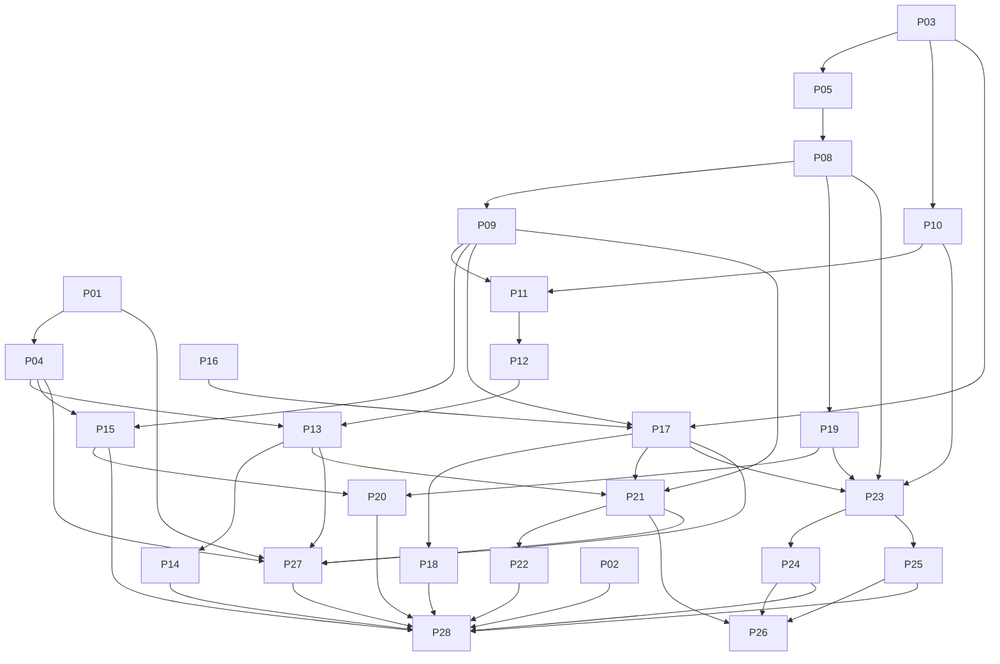

# План реализации Lampa Home

Статус: P01 и ядро конфигурации реализованы; пользователь разрешил слить текущую работу в main. Остальные пункты — план. Каждый пункт ниже — кандидат на один небольшой MR. При расширении scope MR разделяется; параллельные агенты не редактируют один файл без передачи владения. Договоры интерфейсов фиксируются до зависимых задач.

## Актуальное решение: локальная разработка без авторизации

2026-11-10 пользователь отложил авторизацию для текущего домашнего проекта. P06/P07 не входят в ближайший scope и не блокируют Config API, Admin UI и подключение устройств. Следующий этап — P08: LAN Config API поверх готового ядра, затем P09 и Admin UI. Учёт устройства по deviceId и профиля остаётся логической адресацией, а не проверкой доступа. Login, session cookies, token refresh и pairing approval пока не разрабатываем.

Участники домашней LAN смогут читать и менять доступные настройки без входа. Публичный доступ из интернета не входит в этот режим. Валидация, CAS, идемпотентность, server-side secret refs и ограничения connector URL сохраняются. Релиз и публикация образов/IPK сейчас не выполняются; известные upstream test failures не блокируют разрешённое пользователем слияние текущего этапа.

## Последовательность и владельцы

| ID / задача | Область изменений и результат | Приёмка | Зависит от | Риск / модель implementer |
|---|---|---|---|---|
| P01 Baseline upstream | Только build manifests/CI: закреплён SHA и воспроизводимая сборка | pack_github и pack_webos, existing tests; новый lockfile обоснован, runtime assets inventory | Разрешение реализации | Старые npm версии / Terra medium |
| P02 Лицензии | Только notices/license inventory | Конфликт GPL/ISC разрешён либо release блокирован; third-party assets перечислены | — | Права на ресурсы / Sol low исследование |
| P03 Контракты | Только schemas/fixtures/API spec | Config/state/provider version negotiation и examples валидны; нет неизвестных предположений о Proxy | —; предварительная граница без предположений о Proxy | Межрепозиторные решения / Sol low, medium только при конфликте |
| P04 Network baseline | Только harness/tests | Ловит намеренный CUB request через XHR/fetch/script/image/WS; startup trace сохранён | P01 | Динамические mirror domains / Terra medium |
| P05 Config repository | Backend config revisions и SQLite migrations | Atomic publish, CAS race, rollback новым revision, crash-safe transaction | P03 | SQLite durability / Terra medium |
| P06 Admin auth (отложено) | Только login/session/CSRF/rate limits | Удалённый unauth access отклонён; cookie/session expiry, secret redaction | P05 | Auth boundary / Terra medium |
| P07 Pairing/device auth (отложено) | Только pairing и device registry | Короткий TTL, одноразовый код, approval, revoke; device не читает admin API | P06 | Brute force / Terra medium |
| P08 Effective config | Только resolver и read API | global+device merge, schema validation, ETag/304, unsupported schema rejection | P05; P07 отложен | Неоднозначный merge / Terra medium |
| P09 Bootstrap | Только Lampa config bridge/startup | UI стартует offline; invalid config не перезаписывает LKG; media не обрывается | P08,P01 | Порядок upstream init / Terra medium |
| P10 State persistence | Только backend state tables/API | Две сессии, повтор opId, tombstones, cursor expiry и full resync | P03; P07 отложен | Конфликты offline / Terra medium |
| P11 Client state bridge | Только favorite/history/timeline adapters | Локальная запись до сети; outbox retry, offline restart, multi-device convergence | P10,P09 | Старый Account контракт / Terra medium |
| P12 State migration | Только локальный import/migration | Старые profile keys сохраняются; повтор без дублей; backup/reset/restore | P11 | Потеря данных / Terra medium |
| P13 CUB boot/account removal | Только init/account/menu integration | Нет startup/auth/sync CUB; P11 сохраняет local behavior | P04,P11,P12 | Side effects в init / Terra medium |
| P14 CUB secondary removal | Только ads/metrics/remote assets/social gates | Нет вторичных CUB путей; сохранены независимые UI/player capabilities | P13 | Маскировка доменов / Terra medium; разделить на MR по модулям |
| P15 Plugin policy | Только plugin loader/manifest | Отказ unknown URL/digest, offline bundled plugin, запрет remote auto-update | P09,P04 | Произвольный JS / Terra medium |
| P16 Proxy audit | Только отчёт и mapping fixtures | Реальные endpoint/auth/error/image ответы описаны; gaps согласованы | Репозиторий Proxy | Неизвестный контракт / Sol low |
| P17 Metadata adapter | Только transport/provider mapping | search/details/credits/season/images/locales/page, timeout/cancel/error contract tests | P03,P16,P09 | Несовместимые payloads / Terra medium |
| P18 Metadata resilience | Только cache/retry/observability | 429 Retry-After, no retry 401, bounded cache, no key leakage, upstream outage | P17 | Cache poisoning / Terra medium |
| P19 Admin config editor | Только Admin config pages | Schema errors, diff/publish/rollback/global/device; no secrets in export | P08; P06 отложен | Потеря overrides / Terra medium |
| P20 Admin sources/plugins | Только страницы источников/плагинов | Настройка optional endpoints, safe probe, pin plugin version | P15,P19 | SSRF / Terra medium |
| P21 IPK shell | Только packaging и appinfo/assets | main локальный, никаких hosted redirect; offline cold start | P09,P13,P17 | Target webOS engine / Terra medium |
| P22 Remote/player acceptance | Только webOS fixes/tests в узком scope | D-pad/pointer/Back, resume, subtitles/audio tracks на выбранном TV | P21, реальный TV | Аппаратные различия / Terra medium |
| P23 ARM64 release | Только Docker build/reverse proxy/Compose | Native arm64 smoke, pinned digests, non-root API, health independent от Proxy | P08,P10,P17,P19 | Native addon ABI / Terra medium |
| P24 Pi setup wizard | Только setup workflow и provisioning CLI | Clean Pi: проверка preflight, первый admin, pairing; повтор безопасен | P23; P07 отложен | LAN discovery/TLS / Terra medium |
| P25 Backup/upgrade | Только lifecycle tooling | SQLite online backup; restore на пустой volume; несовместимый downgrade блокируется | P23 | DB schema rollback / Terra medium |
| P26 Release manifest/docs | Только фиксированные metadata/templates/runbook | Links/versions/schema статически проверены; нет runtime behavior changes | P21,P24,P25 | Механическая ошибка / Luna medium при полностью заданных полях |
| P27 Upstream update gate | Только CI compatibility suite и patch ledger | Пробный bump или replay baseline; изменения контрактов обнаруживаются | P01,P04,P13,P17,P21 | Drift 3.x / Terra medium |
| P28 End-to-end release review | Отчёт acceptance, без расширения scope | Все проверки ниже пройдены, gaps явно блокируют соответствующий release | P02,P14,P15,P18,P20,P22,P24,P25,P27 | Сквозные несовместимости / Sol medium |

P14 — группа однотипных маленьких MR, а не разрешение объединить удаление рекламы, социальных сервисов и всех сетевых интеграций в один большой MR. P22 также делится по найденным аппаратным дефектам. Proxy production-hardening за пределами P16–18 начинается только после отдельного аудита/разрешения в его репозитории.

## Dependency graph

После контрактов параллельны backend config, state API и аудит Proxy. После bootstrap параллельны plugin policy и metadata mapping; независимое изучение packaging возможно заранее, но интеграционный MR P21 ждёт P17. P03 фиксирует предварительные внутренние контракты; после P16 финальный mapping уточняется в P17, а изменения границы возвращаются координатору на review. Frontend/packaging и Pi lifecycle можно вести независимо после заморозки версии API. Для файлов init/account нужен один владелец и последовательное интегрирование.

## Обязательные release acceptance сценарии

1. **Новый Pi:** Raspberry Pi OS 64-bit, Pi4, пустой data volume, опубликованные ARM64 образы; preflight и wizard приводят к работающей админке без редактирования исходников и без установки TorrServer/Jackett. Повтор setup не сбрасывает БД/пароль. Ошибка download оставляет прежнюю версию работоспособной.
2. **Offline TV:** холодный запуск IPK при отключённом Pi, затем восстановление сети; UI доступен, config обновлён, локальные события доставлены один раз.
3. **CUB zero-egress:** clean и migrated профили, startup/idle/search/details/images/plugins/settings/player/pause/resume; собирать DNS/HTTP(S)/WS назначения и initiators, включая aliases и redirects. Одного блокирующего firewall недостаточно: попытка запрещённого запроса — провал.
4. **State:** два устройства одного профиля, два разных профиля, параллельное добавление/удаление, offline replay, повторные события, restart, rewind и completed reset. Проверить изоляцию профилей и детерминированный результат.
5. **Config:** неверная схема, несовместимая версия, CAS конфликт, rollback, per-device override, недоступный сервер, отозванный device; секретов нет в клиенте/export/log.
6. **Metadata:** реальные ответы Proxy, missing fields, пустой поиск, locales, последняя страница, 401/403/404/429/5xx, timeout/cancel, broken images, stale cache. Контрактные fixtures не заменяют live integration test.
7. **TV playback:** разрешённый набор HLS/MP4/других заявленных форматов и кодеков на реальном TV; focus, Magic Remote, Back/exit, субтитры, дорожки, resume, sleep/wake. Неподдержанные кодеки описаны, не скрыты generic success.
8. **Recovery:** online SQLite backup при записи, восстановление на пустом volume, checksum, config+state+plugin assets; software rollback только с совместимой schema либо восстановлением pre-upgrade backup.
9. **Distribution:** лицензии и notices, corresponding source exact release, images/IPK checksums, версия/совместимость API, процедура установки и ограничения Developer Mode.

## Model routing и review

Координатор и writing-plans: GPT-6.1 Sol low; повышать до medium только для реальной неоднозначности между подсистемами/репозиториями с записанной причиной. Обычная реализация: GPT-6.1 Terra medium. Luna medium разрешена лишь для локальных механических задач с фиксированным входом и детерминированной проверкой (пример P26); неизвестные контракты или несколько подсистем сразу исключают Luna.

Каждый MR проходит сначала **spec compliance review Terra medium**, затем **code quality review Terra medium** после исправления compliance замечаний. Проверяющий получает diff, scope, acceptance и реальные результаты команд. Установка/тесты, которые не запускались, не обозначаются пройденными. Финальное review sub-project и end-to-end acceptance: **Sol medium**. Архитектурное решение Terra эскалирует координатору Sol; Luna после разумной попытки исправления проваленного review передаёт задачу Terra, а не зацикливается.

В этом исследовании: три ограниченных потока аудита/документации — Sol low; проверка итоговых документов — Terra medium. Implementation моделей не было, код не писался. Финальное аппаратное/E2E review будущей реализации не выполнялось; его нельзя заменить review документов. Эскалации реализации отсутствуют.
