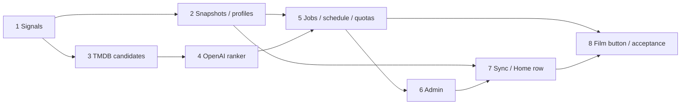

# AI Recommendations Implementation Plan

> **For agentic workers:** REQUIRED SUB-SKILL: Use superpowers:subagent-driven-development or superpowers:executing-plans. Steps use checkbox syntax. User approved parallel implementation after reviewing the plan; execution and acceptance evidence are recorded below.

**Goal:** Daily personalized cards on Home and on-demand cards from a movie/show, using history and favorites.
**Architecture:** Existing Pi Node service + SQLite + TMDB candidate catalog + OpenAI ranking; independent per-device snapshots, profile-scoped batches/jobs from day one.
**Tech Stack:** Node 24, node:sqlite, Ajv, official OpenAI Node SDK, existing Lampa ContentRows/Category, Node tests and Playwright.
**Spec:** [Design](../specs/2026-11-10-ai-recommendations-design.md).

## Global Constraints

- Sing-box/VLESS/network routing is out of scope. No Kubernetes/Redis/PostgreSQL/new service.
- Defaults from spec: profile home; 12 cards; 120 candidates/8 seeds; model gpt-4.1-mini; Moscow 04:00; 8 attempts/profile/day and 32/server; output cap 2500.
- Full device snapshot ≤1000 records and 192 KiB; no local data destruction and no inferred movie/TV ID equivalence.
- Raw OpenAI key stays backend. No key or prompts in logs/client projection/export.
- Existing CUB AI transport is not reused or used as fallback. Full CUB cleanup remains separate.
- One bounded task per MR; each task has an independent acceptance gate. Implementation requires review of this draft first.

## Review Focus

- Legacy source/type ambiguity, overlapping numeric IDs, unlinked timeline hashes, history ≠ completion (T1/T2).
- Snapshot deletion/duplicates/out-of-order delivery and two-device profile separation (T2).
- Paid duplicate calls, restart/timeout/rate-limit, SDK retry and cache invalidation (T4/T5).
- Malicious metadata/AI output, no phantom cards and no key export (T3/T4/T6).
- Remote focus/Back, delayed responses and OpenAI outage must not block normal Lampa (T7/T8).

## Task 1 — Normalize taste signals without uploading them

**Files:** create `src/core/home/recommendations/signals.mjs`; test `server/test/client/recommendation-signals.test.mjs`; record fixtures in `server/test/fixtures/recommendations/`.
**Interface:** `normalizeSignals({favorites,timeline}) -> {records,skipped,digest}`; records carry provider/type/id, flags and episode-aware semantic progress, not streaming URLs. Existing deviceId is consumed later, not regenerated.
**Dependencies:** none. **Risk:** Favorite.history is playback intent; source and type may be ambiguous. Do not reinterpret every category without pinning semantics in fixtures.

- [x] Write tests: movie 42 and TV 42 remain distinct; history-only is not watched; movie 90% is excluded as watched; one episode does not complete a series; like/book/removal and hash-only/CUB unknown IDs handled; same input with different upload time has same digest.
- [x] Run `node --test server/test/client/recommendation-signals.test.mjs`; confirm RED due to missing normalization behavior.
- [x] Implement pure normalizer using observed Favorite/Timeline formats, stable canonical digest and safe limits. No network or writes to native Storage.
- [x] Run tests GREEN; review and commit only this normalizer/fixtures.

## Task 2 — Durable device snapshots and profile partitioning

**Files:** modify `server/src/config/database.mjs`; create `server/src/recommendations/{repository,profiles}.mjs`, `server/src/http/recommendation-routes.mjs`; integrate in `server/src/http/server.mjs`; tests `server/test/recommendations/{repository,signals-api}.test.mjs`; update server test script.
**Interfaces:** `replaceSnapshot({deviceId,seq,digest,records}) -> {acceptedSeq,profileRevision}`; `profileForDevice(deviceId) -> profileId`; `getProfileSignals(profileId) -> snapshot`; routes per design. API validates normalized records itself, not client digest alone.
**Dependencies:** T1 contract. **Risk:** irreversible union or accidental cross-profile access. New tables migrate user_version 2→3 atomically and preserve all existing data. Store signals per device; profile membership is data, not a constant baked into cache keys.

- [x] Write tests for v2 database preservation/reopen; atomic snapshot replacement, duplicate seq+digest, stale seq, same seq/different digest conflict, rejected oversized body unchanged, deletion on one device not clearing another, and profile separation.
- [x] Confirm RED via `node --test server/test/recommendations/repository.test.mjs server/test/recommendations/signals-api.test.mjs`.
- [x] Implement migration and store. Define normalized snapshot v1 schema in `schemas/recommendation-signals.v1.schema.json`. Wire Host/same-origin/body limit/error envelope through existing server guards.
- [x] Run server suite GREEN, review, commit. Acceptance: moving a device to another profile changes aggregation without rewriting its snapshot; local client data remains untouched.

## Task 3 — Metadata candidate catalog

**Files:** create `server/src/recommendations/{metadata,candidates}.mjs`; tests `server/test/recommendations/candidates.test.mjs`.
**Interfaces:** `buildCandidates({profile,seed?,locale,provider,signal}) -> {candidates,seeds,partial}`; `hydrateCards(keys) -> normalized TMDB cards`. MetadataCatalog only issues GET to configured proxy paths `/3/...`; no arbitrary model/user URL fetch.
**Dependencies:** T1 normalized types; T2 profile reader can be fixture-injected.
**Risk:** duplicate names/IDs, unavailable proxy, small candidate pools. Keep movie/TV typed identity; CUB IDs never become TMDB IDs by assumption.

- [x] Write failing fixture-server tests: observed proxy path/query mapping for movie/TV recommendations/similar/discover, locale/pagination, 24-hour cache, at most 3 concurrent calls, 20s deadline, partial failure, adult/watched/started/seed filtering, dedupe and truthful short pools.
- [x] Implement catalog and deterministic candidate selection with max 8 seeds/120 candidates; cap metadata cache size and retain only normalized public fields.
- [x] Run `node --test server/test/recommendations/candidates.test.mjs`; full server suite, review, commit. No real proxy required for this MR.

## Task 4 — OpenAI ranker and strict output validation

**Files:** create `server/src/recommendations/{openai,ranking}.mjs`, `schemas/recommendation-ranking.v1.schema.json`; update `server/package.json`/lock with pinned official SDK; tests `server/test/recommendations/ranking.test.mjs`.
**Interface:** `rankCandidates({candidates,seeds,taste,model,signal}) -> {items,usage,providerRequestId}`; only candidate keys and validated reason codes/seeds accepted. Inject transport and credential resolver for tests.
**Dependencies:** T3 candidate contract. **Risk:** refusal, invalid schema, plausible false explanations or hidden SDK retries.

- [x] Test invalid/unknown/duplicate keys, invalid reasons, unsupported model, refusal, truncated output, 401/403/429/5xx/timeout, abort and prompt-injection metadata; capture logs to assert no key/prompt leakage.
- [x] Observe RED, implement Responses API + Structured Outputs + store=false, maxRetries=0, 2500 output cap and validated reason templates. No tools or secondary paid correction call.
- [x] Run `node --test server/test/recommendations/ranking.test.mjs`; server suite GREEN; review, commit. Transport fixtures replace paid API calls.

## Task 5 — Jobs, daily schedule, quotas and cached delivery

**Files:** create `server/src/recommendations/{jobs,service,scheduler}.mjs`; extend repository/routes; initialize/shutdown worker in `server/src/main.mjs`; tests `server/test/recommendations/jobs.test.mjs` and `recommendation-api.test.mjs`.
**Interfaces:** `requestHome({deviceId,mutationId,now})`, `requestSimilar({deviceId,seed,mutationId,now}) -> {jobId,state}`; `readHome(deviceId)` and `readSimilar(deviceId,seed)` never generate; `runDue(now)` uses injected clock/worker. Batch/job schema and responses exactly follow design.
**Dependencies:** T2–T4.
**Risk:** second TV, cron ticks or profile updates multiplying paid requests; lease expiry overwriting fresh result. Add tables in T2 migration design upfront or a separately numbered additive migration, never silently modify an already released migration.

- [x] RED tests: two concurrent requests yield one job; quota reservation survives timeout/restart; duplicate Idempotency-Key semantics; old fencing token cannot publish; GET makes zero model calls; schedule catches up once; 04:00/day boundaries; expired/negative cache; stale batch on failure; changed history filters served cards without automatic regeneration; each profile has independent cache/jobs and server-wide quota applies.
- [x] Implement single worker, durable jobs/attempt ledger, lease/fencing, transactional budget reservation and max one eligible retry. Do not hold SQLite transactions during HTTP. Publish only a validated result after fresh exclusion filtering.
- [x] Tests GREEN with fake clock/transports; restart/backup restore test includes new tables. Review and commit. No system cron/extra service.

## Task 6 — Admin settings and backend key

**Files:** create `schemas/ai-settings.v1.schema.json`, `server/src/recommendations/settings.mjs`, `server/src/http/ai-admin-routes.mjs`; modify `server/admin/{index.html,admin.js}`, safe public capabilities route; tests `server/test/http/ai-admin.test.mjs`, `server/test/browser/ai-admin.spec.mjs`.
**Interface:** config/status/test endpoints from design; `GET /v1/devices/{id}/recommendations/capabilities -> {enabled,state}` excludes credentials. Keep managed config v1 and client-config exact-key schema unchanged.
**Dependencies:** T2/T5; UI scaffolding may run in parallel with T3/T4 after interface freeze.
**Risk:** accidentally applying LAN Jackett-key permission to OpenAI key, key-containing exports, CAS conflict losing edits or daily quota bypass through Test.

- [x] RED tests for write-only key retention/removal, enabled/model/schedule/limits validation, CAS, no key in public/admin status/export/logs, disabled mode making zero OpenAI calls, and explicit test counting against server budget.
- [x] Implement optional AI config (default disabled), existing secret-store reuse, feature status, counters, last success/error and manual refresh; exports replace refs with unresolved placeholders.
- [x] Browser/server GREEN; review, commit. No network/proxy settings UI or compose routing changes.

## Task 7 — Client snapshot synchronization and Home cards

**Files:** create `src/core/home/recommendations/{client,sync,rows}.mjs` (or `.js` where native imports require it); modify `src/app.js` and Home settings; tests `server/test/client/recommendation-sync.test.mjs`, `server/test/browser/ai-home.spec.mjs`.
**Interfaces:** T1 normalizer + T2 snapshot route + T5 read/job routes + T6 capabilities. Register `ContentRows.add({name:'home_ai',title:'Для тебя',screen:['main'],...})`; explicit refresh control creates a home job, GET only reads.
**Dependencies:** T1/T2/T5/T6.
**Risk:** uploading empty before Favorite is ready, clearing server state after truncation, native main loading waiting on OpenAI, or replacing focus while browsing.

- [x] RED tests using real built app: existing Favorite/Timeline → persisted device signals → cached Home cards; debounced changes/deletion; offline retry with stable seq; empty-vs-not-ready; oversize refusal; device separation; queued/stale/off/error states; manual refresh single-flight and normal catalog remains usable.
- [x] Hook sync after app/Favorite/Timeline readiness using public events, not native state rewrites. Add row via ContentRows, not deprecated main. Keep reason text escaped and native card routing/focus. Cancel view callbacks on activity destruction; never cancel shared server job because one TV left.
- [x] Build WEB, run client/browser suites, review and commit. Acceptance on TV: row navigates with remote; Back returns focus and no playback interruption.

## Task 8 — Film button, acceptance and operations docs

**Files:** create `src/components/home_recommendations.js`, `src/components/full/start/home_recommendations.js`; register in `src/core/component.js`, hook full start module; reuse existing Category/Card mechanisms, not CUB AI API. Tests `server/test/browser/ai-similar.spec.mjs`; docs `docs/ai-recommendations.md`, update deployment/roadmap.
**Interfaces:** seed typed TMDB identity from current card; T5 similar/job endpoints, T6 capabilities; response cards `{card,reason}`.
**Dependencies:** T5–T7; button/component scaffolding may parallel T7 with frozen API.
**Risk:** inaccessible button, old premium/CUB recommendation action, stale results after leaving a card, or identical numeric movie/TV IDs opening wrong detail page.

- [x] RED tests: visible direct film button when enabled (not just hidden options); one on-demand generation; repeat cache hit; expired cache; unsupported source; blank/failure/retry/loading; 12-or-fewer real cards; typed full-card navigation; no CUB AI URL; Back during job, reenter and two TV clients; XSS reason/metadata strings escaped.
- [x] Implement separate Home component/action with no premium gate or CUB fallback. Preserve unrelated legacy AI facts/search; scope removal of obsolete duplicate recommendation action only for the new feature.
- [x] Full server/client/browser/build/helper suites, image build and existing-data restore. Report known upstream test failures separately rather than silently suppressing them. Manual real API test only after key entered in admin, within quota; physical TV checks stay explicit until performed.
- [x] Final Sol medium review of whole subproject and acceptance; update docs with actual measured usage/latency (not invented price), then integrate under session authorization. No release publishing.

## Dependency graph and model routing

Coordinator/design/plans: Sol low; medium only for a concrete boundary ambiguity. Implementation and task spec/quality reviews: Terra medium. Final whole-subproject review: Sol medium. Luna only for a later isolated mechanical task with a deterministic check, not these integration tasks. No model escalation merely because a model is available. If quota blocks a chosen model, report it and adjust routing explicitly; do not repeatedly spawn failed workers.

T2 and T3 can proceed in parallel after T1; T6 UI and T7/T8 client scaffolding may parallel backend work only after exact API/schema freeze. Do not let two agents edit the same routing/main/DB migration files simultaneously: assign one owner and integrate sequentially.

## Decisions to review before execution

- Initial shared profile home, independent device data retained, per-device/profile UI deferred.
- Candidate ranking rather than unconstrained title generation; reasons from verified templates.
- Default inexpensive model and attempt caps; real API prices/account availability checked at execution, no silent model upgrade.
- Whole Pi offline is not equivalent to config/API offline: existing MSX delivery requires Pi for HTML/JS.
- Sing-box and external routing explicitly excluded. The plan can be implemented/tested with fixtures without an OpenAI key.

Only design/planning documents were created for this request. Product code, databases and deployment were not changed.

## Task 9 — Русская озвучка и обратная связь ручных действий

Независимо от T1–T8, допускается параллельная реализация в отдельных файлах. `src/components/torrents.js`, новый pure helper `src/components/torrents/audio-preference.mjs`, `src/interaction/home_settings.js`, минимальное расширение `src/core/home/config.mjs`; новые unit/browser тесты.

- [x] RED: UKR перед RU в ffprobe; RUS dubbing предпочтительнее RUS; смешанные дорожки остаются; субтитры не озвучка; DUB без языка неизвестен; пустые метаданные не маскируются под RU.
- [x] Реализовать корректное отображение/приоритет и понятное управление RU-фильтром без выдуманного определения языка и автопереключения дорожек плеера.
- [x] RED/GREEN ручного Home refresh: начато/применено/без изменений/ошибка, защита от повторного нажатия; фоновая синхронизация без всплывающих сообщений.
- [x] Отдельный task review, затем общий browser/build acceptance вместе с T1–T8.

Execution ledger: `.superpowers/sdd/ai-recommendations/progress.md`; все изменения ведутся по согласованному пользователем параллельному workflow с непересекающимся владением файлами.

## Execution evidence

Implemented in parallel Terra medium workers with disjoint ownership; task reviews also Terra medium. Independent whole-subproject review Sol medium identified and rechecked four integration gaps, all closed. No model escalation was required in this execution. Earlier agent restarts resumed from the ledger rather than redoing completed work.

WEB build, helper suite and server suite passed; native browser acceptance and Docker migration/backup checks are recorded in the execution ledger. Root upstream Vitest preserves its known baseline: 127 passed; episode_menu.spec.js fails because window is undefined; torrent_preload.spec.js fails collection due to missing implementation. No unrelated tests were disabled.

Real API costs/quality, provider connectivity, physical Pi ARM64 and TV remote/playback remain manual acceptance. No OpenAI key was supplied to the workers, no sing-box changes were made, and no release was published. Metadata cache is bounded process memory (24-hour TTL), not persisted; all user state/jobs/batches/attempts remain durable SQLite. Parent's final acceptance numbers are appended after the complete run.

Final coordinator acceptance: 25/25 full browser tests passed on the built client, including native cards/controls, refresh, expired/running jobs and Back; helper tests 10/10; WEB build/checker and Docker image build passed. Docker old v2 data+secret backup → v3 upgrade → restart preserved settings/credentials; old image also started successfully from the v2 backup.

- [ ] External acceptance after the owner enters a key: real OpenAI result quality/usage and physical LG TV/Pi playback. These were not claimed as tested by fixtures.
